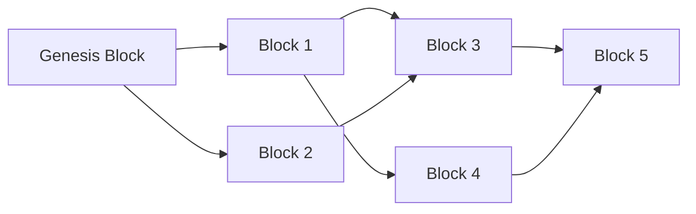

# Rusty Jio — Architecture & Technical Specifications

## 1. Fundamentals of the BlockDAG Architecture

Unlike Bitcoin or traditional blockchains which organize blocks into a linear chain (discarding concurrent blocks as orphans), Rusty Jio implements a **Block Directed Acyclic Graph (BlockDAG)**.

### Core Concepts:

1. **Multiple Parents**:
   - Every block references one or more parent block hashes.
   - Blocks can be mined concurrently and referenced by successor blocks without causing network splits or wasted PoW energy.

2. **GHOSTDAG (Greedy Heaviest Observed Sub-Tree DAG)**:
   - GHOSTDAG orders the DAG blocks into a linear sequence by iteratively picking the heaviest sub-tree.
   - Blocks are partitioned into two sets:
     - **Blue Blocks**: Well-connected blocks created by honest network participants within expected propagation delay boundaries.
     - **Red Blocks**: Delayed, isolated, or potentially adversarial blocks.
   - The parameter **`K`** bounds how many parallel blocks can be admitted to the blue set per step.

3. **Accumulated Blue Work (`BlueWorkType` / `Uint192`)**:
   - In Bitcoin, chain selection relies on cumulative difficulty.
   - In GHOSTDAG, the selected "selected parent" is the parent with the highest **accumulated blue work**.
   - Accumulated work is represented using `Uint192` (192-bit unsigned integer) to prevent any mathematical overflow while avoiding unnecessary overhead.

4. **Difficulty Adjustment Algorithm (DAA)**:
   - Evaluated over a sliding window of historical blocks ordered by their GHOSTDAG sequence.
   - Regulates block production rate smoothly to maintain target block time (e.g. 1 second per block).

5. **Pruning Point**:
   - To prevent unbounded disk growth, past DAG history beyond the finality window is pruned.
   - The node maintains a moving **Pruning Point** block past which full transaction history can be pruned, retaining only the UTXO set and header chain.

---

## 2. Storage & Memory Model

- **Database Engine**: RocksDB with customized prefix schemas for fast range scans and column-family separation.
- **In-Memory Caches**:
  - LRU-bounded block header caches.
  - Reachability indices to answer "does block A precede block B in DAG order?" in $O(1)$ time.
  - UTXO cache keeping hot transaction outputs in RAM.
- **Concurrency & Execution**:
  - Asynchronous I/O powered by Tokio for networking and RPC.
  - Rayon threadpools for parallel compute (e.g. signature verification, PoW evaluation, Merkle tree hashing).
  - Explicit channel-based message passing (`async-channel`) between actors (connection manager, consensus processor, mining subsystem).

---

## 3. Wire Protocols & RPC Interfaces

Rusty Jio supports three primary communication interfaces:
1. **P2P Wire Protocol**: Binary framing with message prefixes, handshake, ping/pong, and continuous block/transaction propagation flows.
2. **gRPC Protocol**: Protobuf-based client-server RPC for standard multi-language integrations.
3. **wRPC (WebSocket RPC)**: High-performance WebSocket framing utilizing **Borsh** (binary serialization) for inter-process speed, and **JSON** for web browsers and JavaScript/TypeScript clients.

