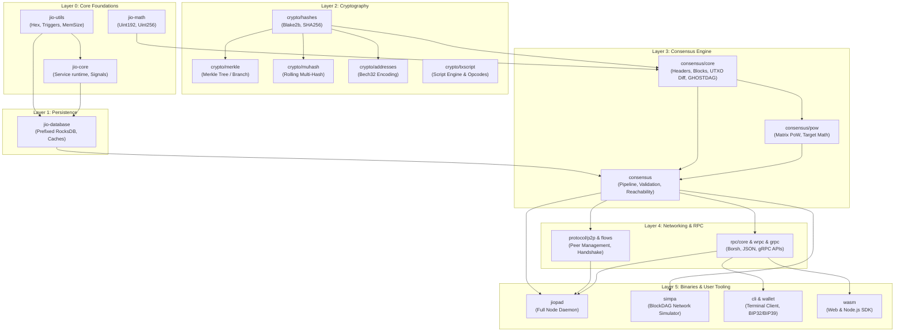

# Rusty Jio — Master Project Plan & Roadmap

## 1. Executive Summary & Vision

**Rusty Jio** is a high-performance, asynchronous Rust implementation of the Jio BlockDAG full-node, consensus engine, and surrounding ecosystem.

Unlike traditional linear blockchains (such as Bitcoin or Ethereum), Jio utilizes a **Directed Acyclic Graph (BlockDAG)** governed by the **GHOSTDAG (Greedy Heaviest Observed Sub-Tree DAG)** consensus protocol. This allows for:
- Concurrent block creation without orphan blocks.
- Sub-second confirmation latencies.
- High transaction throughput (scaling from 1 BPS to 10+ BPS and beyond).
- Secure proof-of-work consensus with rapid difficulty adjustment (DAA).

The primary goal of this project is to develop a clean, modular, production-ready, safe, and fully tested Rust implementation from scratch.

---

## 2. System Architecture & Crate Taxonomy

The workspace is organized into modular crates with clear dependency boundaries:

---

## 3. Phased Development Roadmap

### Phase 1: Foundational Math & System Utilities *(In Progress)*
- **Crates**: Root `Cargo.toml`, `math`, `utils`
- **Deliverables**:
  - Root workspace setup with unified compiler flags, profiles, and dependencies.
  - Multi-precision unsigned integer primitives: `Uint192` (blue work) and `Uint256` (PoW targets, hashes).
  - High-performance hex encode/decode routines.
  - Shutdown triggers, coordination primitives, and memory size tracking.
- **Verification**: Complete unit test coverage for math operations (addition, subtraction, multiplication, division, shifts, byte conversions).

### Phase 2: Runtime Core & Database Storage Engine
- **Crates**: `core`, `database`
- **Deliverables**:
  - `jio-core`: Background service lifecycle manager (`AsyncService`, `ServiceManager`), graceful shutdown orchestration.
  - `jio-database`: RocksDB wrapper with column families, key prefixing, memory-bounded LRU caches, batch atomic commits.
- **Verification**: Mock persistence tests, prefix separation tests, cache eviction tests.

### Phase 3: Cryptographic Primitives & Address Format
- **Crates**: `crypto/hashes`, `crypto/merkle`, `crypto/muhash`, `crypto/addresses`, `crypto/txscript`
- **Deliverables**:
  - Standard and keyed hashing (Blake2b with domain separation tags, SHA256).
  - Merkle tree calculations for block transactions.
  - MuHash rolling set hash for incremental UTXO set commitment.
  - Bech32 address format encoding/decoding (`jio:`, `jiotest:` prefixes, Schnorr public key payloads, script payloads).
  - Transaction script engine (opcodes, signature hashing sighash types, stack machine).
- **Verification**: Official test vectors for hashes, Merkle root verification, Bech32 roundtrip encode/decode.

### Phase 4: Consensus Core Domain Models
- **Crates**: `consensus/core`
- **Deliverables**:
  - Core structures: `Header`, `Block`, `Transaction`, `TransactionInput`, `TransactionOutput`, `SubnetworkId`.
  - Block header hashing and double-hashing logic.
  - UTXO collection, UTXO diffs, and reversible state transitions.
  - Network parameters (Mainnet, Testnet, Devnet, Simnet) with genesis block definitions.
  - GHOSTDAG data types: blue work, blue score, DAA score, merge sets.
- **Verification**: Serialization/deserialization tests (Bincode/Borsh), header hashing benchmarks, UTXO diff arithmetic.

### Phase 5: Proof of Work & Mining Subsystem
- **Crates**: `consensus/pow`, `mining`
- **Deliverables**:
  - Heavy-hash / matrix-based PoW algorithm implementation.
  - Target calculation, compact bits conversion, difficulty boundary verification.
  - Block template builder for miners.
  - Multi-threaded CPU mining worker and submission loop.
- **Verification**: PoW target validation against known block hashes, matrix multiplication correctness.

### Phase 6: Consensus Engine & BlockDAG Processing Pipeline
- **Crates**: `consensus`
- **Deliverables**:
  - In-memory DAG representation and reachability tree algorithm (O(1) reachability queries between arbitrary blocks).
  - GHOSTDAG sorting algorithm: blue set selection, past/future DAG traversal.
  - Difficulty Adjustment Algorithm (DAA) calculation over moving windows.
  - Transaction validation rules (mass calculation, fee check, signature verification).
  - Pruning point algorithm and finality management.
- **Verification**: Multi-block DAG construction tests, chain reorganization tests, pruning window verification.

### Phase 7: P2P Protocol & RPC Communication Layer
- **Crates**: `protocol/p2p`, `protocol/flows`, `rpc/core`, `rpc/grpc`, `rpc/wrpc`
- **Deliverables**:
  - Asynchronous P2P connection manager and address manager.
  - P2P flows: handshake, ping/pong, block headers exchange, block relay, transaction inventory.
  - RPC services: high-speed wRPC (WebSocket + Borsh/JSON) and gRPC for client integrations.
- **Verification**: Simulated peer-to-peer message exchanges, RPC request-response roundtrips.

### Phase 8: Full-Node Daemon, Simulation & User Applications
- **Crates**: `jiopad`, `simpa`, `cli`, `wallet/*`, `wasm`
- **Deliverables**:
  - `jiopad`: Main executable uniting consensus, storage, P2P network, and RPC servers.
  - `simpa`: Simulation harness capable of testing BlockDAG topologies under synthetic latency and load.
  - `cli` & `wallet`: Command-line wallet for account generation, key derivation (BIP-32/39), and transaction crafting.
  - `wasm`: Browser and Node.js bindings for decentralized application integration.
- **Verification**: End-to-end local network test with mining and transaction propagation.

---

## 4. Engineering Standards & Quality Gates

1. **Safety**: `#![deny(unsafe_code)]` wherever possible. Unsafe code is permitted only in performance-critical low-level math or matrix kernels, requiring explicit `// SAFETY:` justifications.
2. **Determinism**: Consensus validation logic must be completely deterministic across all supported platforms (x86_64, aarch64, Windows, Linux, macOS).
3. **Zero Warnings**: All crates must pass `cargo check` and `cargo clippy --all-targets -- -D warnings`.
4. **Test-Driven Delivery**: Each stage must achieve comprehensive test coverage before progressing to dependent downstream crates.

