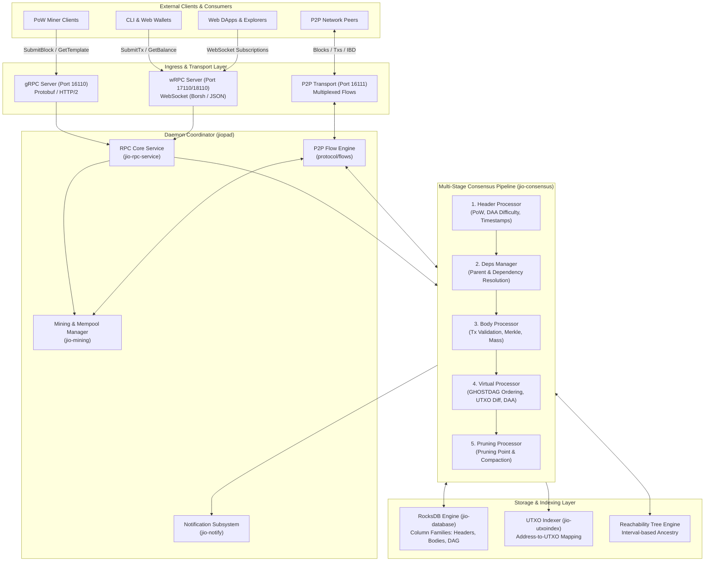
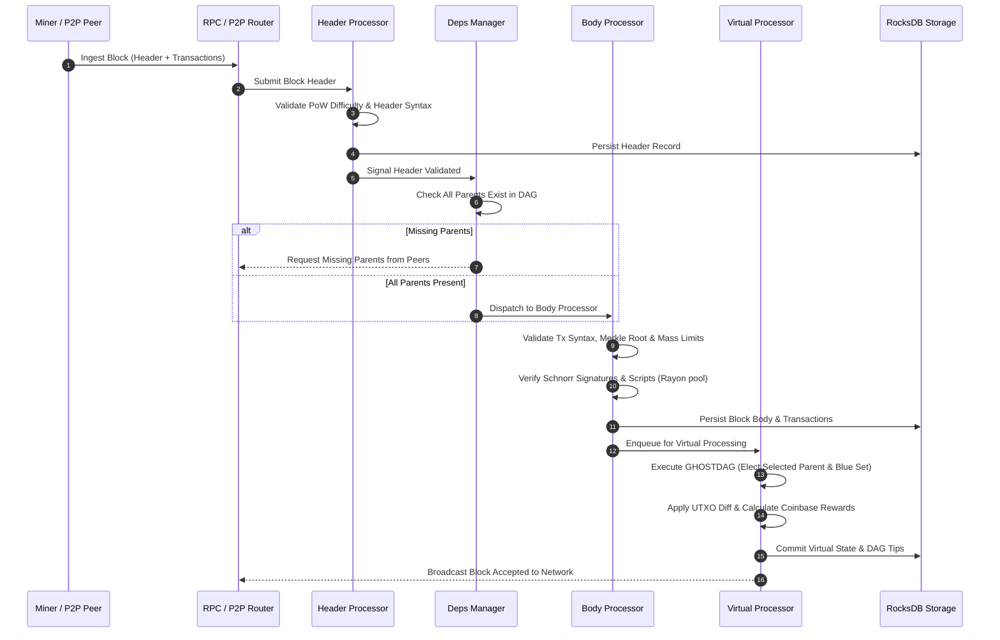
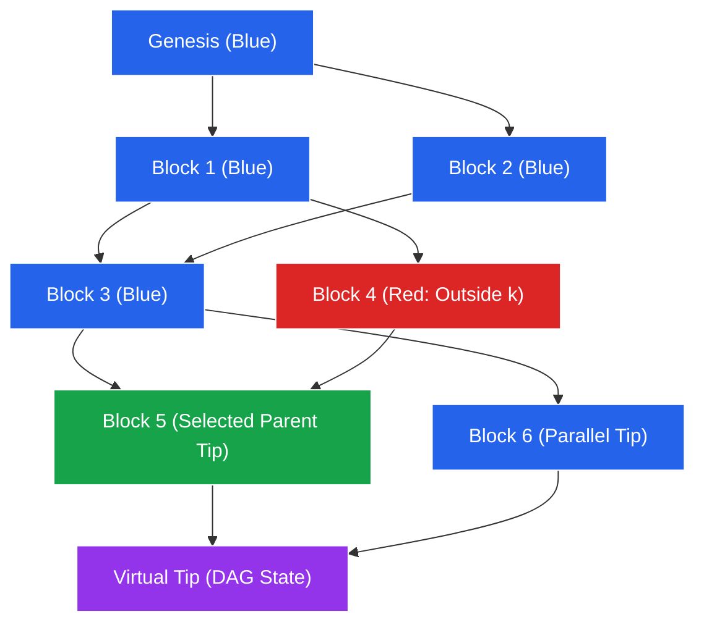
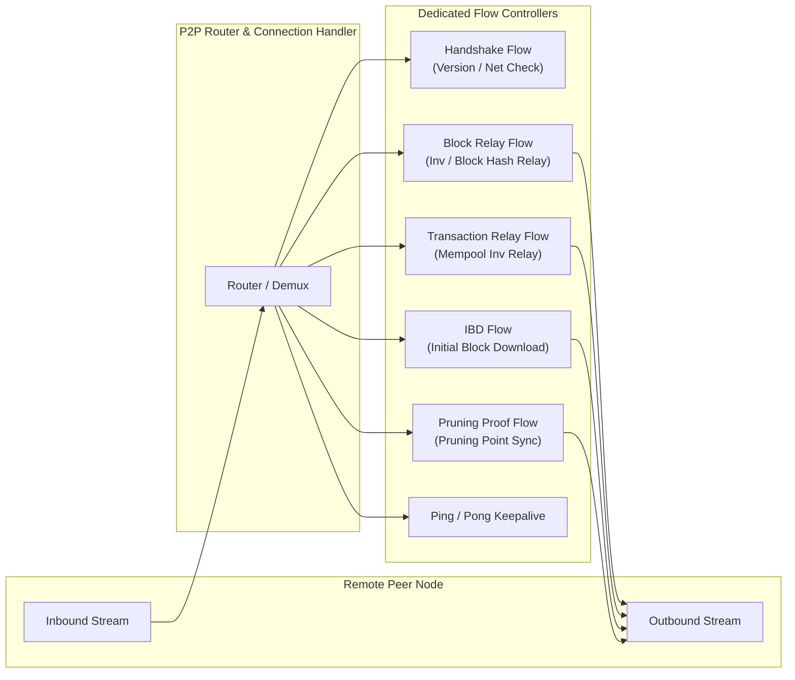
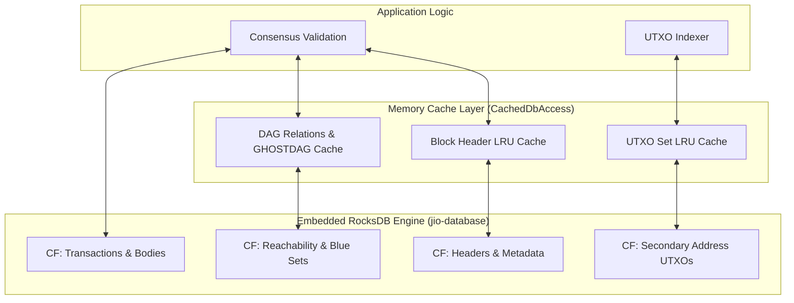
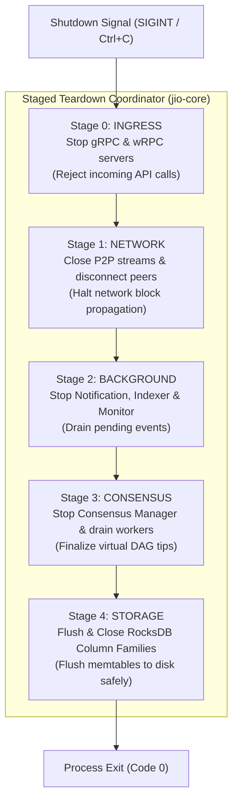

# System Design Architecture: rusty-jio

> **Repository:** `rusty-jio`  
> **Architecture Paradigm:** Asynchronous BlockDAG Full-Node & Tooling Ecosystem  
> **Consensus Protocol:** GHOSTDAG (Generalization of Nakamoto Consensus)  
> **Implementation Language:** Rust (2024 Edition)  
> **Date:** October 2026  

---

## 1. Executive Summary & Architectural Overview

`rusty-jio` is a high-throughput, proof-of-work (PoW) cryptocurrency node built around a **Directed Acyclic Graph (BlockDAG)** rather than a linear blockchain. In contrast to traditional blockchains (which discard orphan blocks created in parallel), `rusty-jio` incorporates all valid mined blocks into the DAG structure and algorithmically orders them using **GHOSTDAG** (Greedy Heaviest Observed Subtree DAG).

### Core Architectural Characteristics
1. **High Block Rate (BPS):** Enables multiple blocks per second without compromising network security.
2. **Sub-second Settlement:** Rapid transaction inclusion into DAG tips with quick confirmation times.
3. **Pipelined Asynchronous Ingestion:** Decoupled block validation across discrete worker queues.
4. **Dual Ingress RPC:** High-performance gRPC (Protobuf) for backends/miners and WebSocket wRPC (Borsh binary & JSON) for browsers/WASM.
5. **Zero-Overhead DAG Reachability:** Fast $O(1)$ topological ancestry checks using re-indexable interval trees.



---

## 2. Multi-Stage Consensus Pipeline

Block ingestion and validation is decoupled into a staged pipeline connected via asynchronous bounded channels. Each stage runs independently, preventing slow validations (e.g., cryptographic signature checks) from blocking header propagation across the network.



### Pipeline Stages Explained
1. **Header Processor (`header_processor`):**
   - Verifies the Proof-of-Work (PoW) hash matches target difficulty.
   - Validates past median time (PMT) and timestamp sanity.
   - Computes DAA (Difficulty Adjustment Algorithm) score.
2. **Dependencies Manager (`deps_manager`):**
   - Ensures all DAG parents referenced in the block header are known and validated.
   - Holds blocks in staging if parent dependencies are currently traversing the network.
3. **Body Processor (`body_processor`):**
   - Validates transaction mass (computational and storage limit).
   - Validates Merkle roots for transactions and accepted IDs.
   - Parallelizes transaction cryptographic signature verification using `rayon`.
4. **Virtual Processor (`virtual_processor`):**
   - Updates the BlockDAG "virtual" tip representing the global state.
   - Computes GHOSTDAG ordering, blue work, and selected parent.
   - Calculates the UTXO changes, fees, and coinbase maturity.
5. **Pruning Processor (`pruning_processor`):**
   - Derives the network pruning point to allow historical block compaction without breaking validation for late syncers.

---

## 3. GHOSTDAG Protocol & Reachability Subsystem

### 3.1 GHOSTDAG Consensus Algorithm
Unlike Bitcoin (which selects the single longest chain), Jio permits blocks to reference multiple parents, forming a DAG. **GHOSTDAG** solves the two-generals consensus problem on DAGs:

* **Selected Parent:** For any block $B$, its selected parent is the parent with the highest cumulative blue work.
* **Selected Parent Chain:** Walking back along selected parents yields the main chain spine.
* **Blue Set vs. Red Set:** Blocks created in parallel within an anticone bound $k$ are elected as **Blue** (honest, cooperative blocks receiving full rewards and ordered topologically); blocks outside $k$ are labeled **Red** (delayed or adversarial blocks).



### 3.2 Interval-Tree Reachability Engine
To check whether block $A$ is an ancestor of block $B$ in standard DAGs requires expensive breadth-first search traversals. `rusty-jio` implements an **interval-tree reachability data structure** (`consensus/src/processes/reachability/`):
- Assigns each block an integer interval $[start, end]$ along the selected parent tree.
- A block $A$ is an ancestor of $B$ if and only if $B.interval \subseteq A.interval$.
- Reduces reachability queries from $O(|V| + |E|)$ to **$O(1)$ constant time**.

---

## 4. P2P Networking & Flow Architecture

P2P networking (`protocol/p2p` & `protocol/flows`) uses channel-based flow multiplexing over gRPC/Protobuf streams:



* **Flow Isolation:** Each protocol interaction runs as an isolated asynchronous task with dedicated bounded channels. If one flow stalls (e.g., waiting for block data), ping and transaction relay flows continue without head-of-line blocking.
* **Initial Block Download (IBD):** New nodes perform fast synchronization by downloading a cryptographic pruning proof, validating the latest pruning point, and only syncing full block bodies from that point forward.

---

## 5. Dual-Protocol RPC Architecture

`rusty-jio` exposes two specialized RPC interfaces through `jio-rpc-service`:

```mermaid
flowchart TD
    subgraph ExternalConsumers["External Consumers"]
        BackendMiners["Mining Pools / Stratum Daemons"]
        WebApps["Web Applications / Browsers"]
        Wallets["Desktop & CLI Wallets"]
    end

    subgraph RPCLayer["RPC Interface Layer"]
        GRPCServer["jio-grpc-server<br/>Port: 16110<br/>Format: Protobuf (HTTP/2)"]
        WRPCServer["jio-wrpc-server<br/>Ports: 17110 (Borsh) / 18110 (JSON)<br/>Format: WebSocket"]
        WRPCProxy["jio-wrpc-proxy<br/>WebSocket Reverse Proxy"]
    end

    subgraph RpcCore["RPC Core Service"]
        ServiceDispatcher["jio-rpc-service Dispatcher"]
        Notifier["jio-notify Root<br/>Event Broadcaster"]
    end

    BackendMiners -->|gRPC Calls| GRPCServer
    WebApps -->|WebSocket (Borsh/JSON)| WRPCServer
    Wallets -->|WebSocket / gRPC| WRPCServer
    WebApps -.->|WSS Reverse Proxy| WRPCProxy
    WRPCProxy --> WRPCServer

    GRPCServer --> ServiceDispatcher
    WRPCServer --> ServiceDispatcher
    Notifier --> GRPCServer
    Notifier --> WRPCServer
```

| Dimension | gRPC Server (`jio-grpc-server`) | wRPC Server (`jio-wrpc-server`) |
|---|---|---|
| **Primary Use-Case** | Miners, node-to-node integrations, backend services | Web frontends, WASM applications, mobile wallets |
| **Transport** | HTTP/2 streaming | WebSocket (persistent bidirectional) |
| **Serialization** | Protocol Buffers (compact, typed) | **Borsh** (binary zero-copy) or **Serde JSON** |
| **Default Ports** | `16110` (Mainnet) / `16210` (Testnet) | `17110` (Borsh) / `18110` (JSON) |
| **Pub/Sub Events** | Server-side gRPC streams | WebSocket JSON/Borsh notification frames |

---

## 6. Storage & Indexing Subsystem

Storage is handled by RocksDB with typed column families and multi-threaded caching:



* **Batch Writers (`BatchDbWriter`):** Atomic batch commits ensure that block headers, bodies, and UTXO state are written transactionally.
* **UTXO Indexer (`jio-utxoindex`):** A secondary index service mapping addresses to unspent transaction outputs (UTXOs), enabling instantaneous wallet balance queries without scanning the entire DAG.

---

## 7. Daemon Lifecycle & Staged Shutdown Coordinator

To prevent socket leaks, database corruption, or worker panics on daemon shutdown (e.g., on `SIGINT` / `Ctrl+C`), `rusty-jio` uses an ordered, multi-stage shutdown coordinator:



---

## 8. Subsystem & Crate Inventory

```
rusty-jio/
├── core/                        # Async runtime, logger, panic hook, shutdown signals
├── consensus/                   # BlockDAG GHOSTDAG engine, validation pipeline, DAA
│   ├── core/                    # Core blockchain types (Block, Transaction, Header)
│   ├── notify/                  # Consensus notification channels
│   └── pow/                     # Proof-of-work hash calculations & difficulty
├── components/                  # Coordination components (AddressManager, ConnectionManager)
├── crypto/                      # Primitives: Hashes (Blake2b), MuHash, Addresses, TxScript
├── database/                    # RocksDB abstractions, caches, atomic batch writers
├── indexes/                     # UTXO indexer & secondary processor
├── jiopad/                      # Main full-node binary executable
├── mining/                      # Mempool, block template builder, tx mass accounting
├── notify/                      # Global publish-subscribe notification routing
├── protocol/                    # P2P engine (gRPC transport + flows)
├── rpc/                         # Multi-protocol API: gRPC (HTTP/2) + wRPC (WebSocket)
├── simpa/                       # In-process BlockDAG network simulation binary
└── wallet/                      # HD wallet (BIP32/BIP39), native CLI, and WASM bindings
```

---

*System Architecture Document for `rusty-jio`.*
